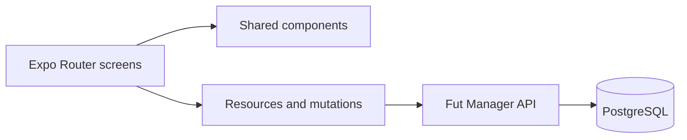

# Fut Manager · App

**English** | [Português (Brasil)](README.pt-BR.md)


Fut Manager is a personal project that brings amateur football organization from group chats into an app: gathering players, building teams, following matches, and keeping a record of tournament achievements.

The experience was built for use on the pitch and has already been tested in a real tournament. The project is evolving toward an MVP, with improvements based on that experience.

## A complete experience for players and organizers

| For players | For organizers |
| --- | --- |
| Join groups and teams by invitation | Approve join requests and manage squads |
| Confirm attendance as an outfield player or goalkeeper | Configure capacity and waiting lists |
| Follow matches and statistics | Build and balance teams |
| Browse rankings and trophies | Record match reports, results, and penalties |
| Follow tournaments without entering | Create competitions and draw groups |

## Tournaments and teams

The app offers **leagues, group stages + knockout rounds, single elimination, and Cascade brackets**. Each edition has a menu for registration, teams, matches, results, standings, rankings, and trophies.

- **Flexible leagues:** any number of teams starting from two, with a single round robin or home-and-away matches and byes for odd numbers.
- **Group draws:** random assignment alongside manual adjustments before match records are entered.
- **Starting goalkeepers:** predefined by the team and filled in automatically for each fixture. Organizers confirm substitutions during a match; conceded goals are tracked for each goalkeeper.
- **Walkovers:** a 3–0 win for the team that attends, without assigning goals to players.
- **Penalties:** points deductions or disqualification from the edition, with a recorded reason and a review step before confirmation.
- **Compact match reports:** repeated events are grouped, such as `2x Goals · Player`, while still allowing one occurrence to be removed during the match.
- **Trophy rooms:** teams keep their tournament titles, and collective awards are displayed under the team's name in each edition.
- **Individual awards:** one winner for top scorer, assists, and best goalkeeper, with team placement breaking ties.
- **Tournament feed:** matches, results, and statistics available to any authenticated user, even without registering a team.

## Pickup games and seasons

Groups support members, guest players, recurring events, attendance confirmation, waiting lists, team selection, a match timer, and records of goals, assists, and cards. Rankings and seasons preserve historical results; player profiles bring together preferred positions and achievements.

Administrators can configure team draws to consider positions, ratings, and performance. Invitation codes remain private and can be regenerated by the person responsible.

## Technology

**Expo SDK 57 · React Native · React 19 · TypeScript · Expo Router**

One codebase supports Android, iOS, and the web. Current distribution focuses on **web/PWA**, with configuration for native builds. Shared components provide the same match report and ranking experience across pickup games and tournaments.

The app consumes the **Fut Manager API**, a companion project built with Python/FastAPI and PostgreSQL. The API enforces permissions and competition rules and protects stored personal data.



## Run locally

1. Install a Node.js version compatible with SDK 57 and install dependencies with `npm ci`.
2. Configure `EXPO_PUBLIC_API_URL` in a private `.env.local`, following `.env.example`.
3. Start the companion API with its migrations up to date.
4. Run:

```powershell
npm start
```

For the web version, run `npm run web`. Generate the PWA with `npm run build:pwa`. Native build instructions are in [BUILD_ANDROID.md](BUILD_ANDROID.md) (Portuguese).

Variables beginning with `EXPO_PUBLIC_*` are public in the bundle: use them only for client configuration, never for database credentials or encryption keys.

## Quality and structure

```powershell
npm run lint -- --no-cache
npx tsc --noEmit
node --test tests/*.test.mjs
```

- `src/app`: screens and navigation.
- `src/components`: tournament, match, ranking, and form components.
- `src/hooks`: resource loading and mutations.
- `src/services`: API contracts and utilities.
- `src/contexts`: authentication and session state.
- `public`: PWA resources.

## More about the project

- [Changes following tournament testing (Portuguese)](Feedback.md)
- [Previous technical documentation (Portuguese)](docs/DEVELOPMENT.md)
- [Android builds (Portuguese)](BUILD_ANDROID.md)

Developed by **Pedro Vieira** as a personal portfolio project.
