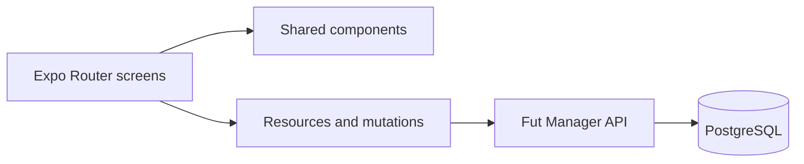
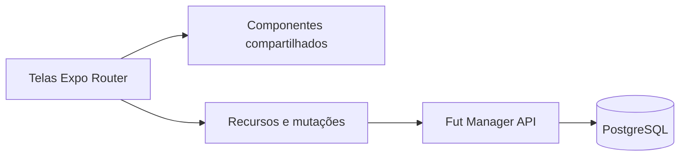

# Fut Manager · App

[English](#english) · [Português (Brasil)](#portugues-brasil)

<a id="english"></a>

## English

[English](#english) · [Português (Brasil)](#portugues-brasil)


Fut Manager is a personal project that brings amateur football organization from group chats into an app: gathering players, building teams, following matches, and keeping a record of tournament achievements.

The experience was built for use on the pitch and has already been tested in a real tournament. The project is evolving toward an MVP, with improvements based on that experience.

### Engineering decisions and code to explore

Developed by **[Pedro Vieira](https://github.com/pedro-vlps)** as an end-to-end portfolio project, connecting product requirements, cross-platform UI, typed API integration, testing, and delivery. These implementation details demonstrate frontend and mobile engineering:

| Challenge | Implementation | Code / evidence |
| --- | --- | --- |
| Prevent stale responses from replacing current data | Resource hooks associate results with the route and session token and invalidate outdated requests with a generation counter | [useApiResource](src/hooks/use-api-resource.ts) |
| Avoid duplicate submissions | A synchronous ref lock guards mutations, with busy/error state and handling of expired sessions | [useMutation](src/hooks/use-mutation.ts) |
| Keep API integration consistent | A shared typed request function applies bearer authentication, a 15-second timeout, HTTP error mapping, and support for empty responses | [API client](src/services/api.ts) |
| Share one application across screen sizes | Expo Router and shared components serve native mobile and responsive web layouts; browser detection and breakpoints have unit tests | [Layouts](src/contexts/responsive.tsx), [responsive rules](src/services/responsive-layout.ts), [tests](tests/responsive-layout.test.mjs) |
| Handle dates and input rules predictably | Pure TypeScript helpers implement event time zones and Unicode-aware password validation | [Date tests](tests/event-time.test.mjs), [password tests](tests/password-policy.test.mjs) |
| Deliver a reproducible web build | The Docker build exports the PWA; Caddy serves static assets and proxies same-origin `/api` requests to the backend | [Dockerfile](Dockerfile), [Caddyfile](Caddyfile), [PWA build](scripts/build-pwa.cjs) |

**Current tradeoffs:** distribution focuses on web/PWA; native builds are configured separately. Automated tests currently cover pure domain utilities, not end-to-end screen interactions. TypeScript checks static contracts; server responses still require server-side validation. Permissions and final competition decisions are enforced by the API.

### A complete experience for players and organizers

| For players | For organizers |
| --- | --- |
| Join groups and teams by invitation | Approve join requests and manage squads |
| Confirm attendance as an outfield player or goalkeeper | Configure capacity and waiting lists |
| Follow matches and statistics | Build and balance teams |
| Browse rankings and trophies | Record match reports, results, and penalties |
| Follow tournaments without entering | Create competitions and draw groups |

### Tournaments and teams

The app offers **leagues, group stages + knockout rounds, single elimination, and Cascade brackets**. Each edition has a menu for registration, teams, matches, results, standings, rankings, and trophies.

- **Flexible leagues:** any number of teams starting from two, with a single round robin or home-and-away matches and byes for odd numbers.
- **Group draws:** random assignment alongside manual adjustments before match records are entered.
- **Starting goalkeepers:** predefined by the team and filled in automatically for each fixture. Organizers confirm substitutions during a match; conceded goals are tracked for each goalkeeper.
- **Walkovers:** a 3–0 win for the team that attends, without assigning goals to players.
- **Penalties:** points deductions or disqualification from the edition, with a recorded reason and a review step before confirmation.
- **Compact match reports:** repeated events are grouped, such as `2x Goals · Player`, while still allowing one occurrence to be removed during the match.
- **Trophy rooms:** teams keep their tournament titles, and collective awards are displayed under the team's name in each edition.
- **Individual awards:** one winner for top scorer, assists, and best goalkeeper, with team placement breaking ties.
- **Tournament feed:** matches, results, and statistics available to any authenticated user, even without registering a team.

### Pickup games and seasons

Groups support members, guest players, recurring events, attendance confirmation, waiting lists, team selection, a match timer, and records of goals, assists, and cards. Rankings and seasons preserve historical results; player profiles bring together preferred positions and achievements.

Administrators can configure team draws to consider positions, ratings, and performance. Invitation codes remain private and can be regenerated by the person responsible.

### Technology

**Expo SDK 57 · React Native · React 19 · TypeScript · Expo Router**

One codebase supports Android, iOS, and the web. Current distribution focuses on **web/PWA**, with configuration for native builds. Shared components provide the same match report and ranking experience across pickup games and tournaments.

The app consumes the **Fut Manager API**, a companion project built with Python/FastAPI and PostgreSQL. The API enforces permissions and competition rules and protects stored personal data.



### Run locally

1. Install a Node.js version compatible with SDK 57 and install dependencies with `npm ci`.
2. Configure `EXPO_PUBLIC_API_URL` in a private `.env.local`, following `.env.example`.
3. Start the companion API with its migrations up to date.
4. Run:

```powershell
npm start
```

For the web version, run `npm run web`. Generate the PWA with `npm run build:pwa`. Native build instructions are in [BUILD_ANDROID.md](BUILD_ANDROID.md) (Portuguese).

Variables beginning with `EXPO_PUBLIC_*` are public in the bundle: use them only for client configuration, never for database credentials or encryption keys.

### Responsive web delivery

The same PWA serves phones, tablets, and desktop browsers. Phones and tablets keep the mobile interface, while desktop browsers get a sidebar and multi-column lists that adapt to the window width. Layout selection follows the browser identification; requesting the desktop site uses the browser's own setting. Native builds keep the mobile layout.

Desktop and mobile web share the same API, permissions, and deployment. Rebuild with `npm run build:pwa`; the existing hosting flow serves `dist`.

### Quality and structure

```powershell
npm run lint -- --no-cache
npm run typecheck
npm test
```

- `src/app`: screens and navigation.
- `src/components`: tournament, match, ranking, and form components.
- `src/hooks`: resource loading and mutations.
- `src/services`: API contracts and utilities.
- `src/contexts`: authentication and session state.
- `public`: PWA resources.

### Continuous integration and Railway

Both repositories are deployed on Railway, with automatic redeployment from `main`. GitHub Actions runs on **every push and pull request**, and can also be started manually.

The [app workflow](.github/workflows/tests.yml) uses Node 22.22.0 and `npm ci`, then runs `npm test`, lint, TypeScript checking, and the production PWA build. The unit suite covers dates/time zones, password policy, and responsive layout; it does not need a live backend.

The existing private-configuration and secret-history checks also remain enabled.

**Required Railway setting:** workflows alone do not block the existing automatic deployment. In **each service**, open **Settings → Source → Wait for CI** and enable it, keeping `main` as the deployment branch. After publishing the workflow, accept any pending Railway GitHub App permission update if the option is unavailable. This is a service setting, not a `railway.json` property.

With **Wait for CI enabled**, Railway waits for the commit's GitHub Actions workflows; a failed workflow skips that deployment. Push runs are not automatically cancelled by these workflows. Confirm the integration on the next `main` push: the deployment should wait for CI, proceed after successful checks, and be skipped when a workflow fails. **Until that setting is enabled, automatic deployment is not protected by these tests.** See [Railway's autodeploy documentation](https://docs.railway.com/deployments/github-autodeploys).

### More about the project

- [Changes following tournament testing (Portuguese)](Feedback.md)
- [Previous technical documentation (Portuguese)](docs/DEVELOPMENT.md)
- [Android builds (Portuguese)](BUILD_ANDROID.md)

Developed by **Pedro Vieira** as a personal portfolio project.

---

<a id="portugues-brasil"></a>

## Português (Brasil)

[English](#english) · [Português (Brasil)](#portugues-brasil)


Fut Manager é um projeto pessoal para levar a organização do futebol amador do grupo de mensagens para um aplicativo: reunir jogadores, montar times, acompanhar partidas e guardar as conquistas de cada campeonato.

A experiência foi construída para uso em campo e já foi testada em um campeonato real. O projeto está em evolução rumo ao MVP, com melhorias baseadas nesse uso.


### Decisões de engenharia e código para explorar

Desenvolvido por **[Pedro Vieira](https://github.com/pedro-vlps)** como projeto de portfólio de ponta a ponta, conectando requisitos de produto, interface multiplataforma, integração tipada com a API, testes e entrega. Estas decisões demonstram desenvolvimento frontend e mobile:

| Desafio | Implementação | Código / evidência |
| --- | --- | --- |
| Evitar que respostas antigas substituam os dados atuais | Hooks associam resultados à rota e ao token da sessão e invalidam requisições antigas com um contador de geração | [useApiResource](src/hooks/use-api-resource.ts) |
| Impedir envios duplicados | Uma trava síncrona com ref protege mutações, com estado de processamento, erro e tratamento de sessão expirada | [useMutation](src/hooks/use-mutation.ts) |
| Padronizar a integração HTTP | Cliente tipado centraliza autenticação bearer, timeout de 15 segundos, erros HTTP e respostas sem conteúdo | [Cliente da API](src/services/api.ts) |
| Compartilhar a aplicação entre tamanhos de tela | Expo Router e componentes compartilhados atendem mobile nativo e web responsiva; identificação do navegador e breakpoints têm testes unitários | [Layouts](src/contexts/responsive.tsx), [regras responsivas](src/services/responsive-layout.ts), [testes](tests/responsive-layout.test.mjs) |
| Tratar datas e entradas de forma previsível | Helpers puros em TypeScript implementam fusos de eventos e validação de senhas considerando Unicode | [Testes de datas](tests/event-time.test.mjs), [testes de senhas](tests/password-policy.test.mjs) |
| Reproduzir a entrega web | O build Docker exporta a PWA; Caddy serve arquivos estáticos e encaminha `/api` na mesma origem para o backend | [Dockerfile](Dockerfile), [Caddyfile](Caddyfile), [build da PWA](scripts/build-pwa.cjs) |

**Limites atuais:** a distribuição prioriza web/PWA; builds nativos têm configuração própria. Os testes automatizados cobrem utilitários de domínio, sem testes ponta a ponta das telas. TypeScript verifica contratos estáticos; respostas ainda dependem da validação no servidor. Permissões e decisões finais da competição são aplicadas pela API.


### Uma jornada completa para jogar e organizar

| Para os jogadores | Para os organizadores |
| --- | --- |
| Entrar em grupos e times por convite | Aprovar pedidos e gerenciar elencos |
| Confirmar presença como jogador ou goleiro | Configurar vagas e listas de espera |
| Acompanhar partidas e estatísticas | Montar e equilibrar times |
| Consultar rankings e troféus | Registrar súmulas, resultados e punições |
| Seguir campeonatos sem participar | Criar competições e sortear grupos |

### Campeonatos e times

O aplicativo oferece **liga, grupos + mata-mata, mata-mata e cascata**. Cada edição tem um menu com inscrições, times, jogos, resultados, classificações, rankings e troféus.

- **Liga livre:** qualquer quantidade de times a partir de dois, com turno único ou ida e volta e folgas para quantidades ímpares.
- **Sorteio de grupos:** distribuição aleatória, além do ajuste manual antes dos registros de jogo.
- **Goleiro titular:** predefinido pelo time e preenchido automaticamente nos jogos. O organizador confirma as substituições durante a partida, com gols sofridos contabilizados para cada goleiro.
- **WO:** vitória de 3 a 0 para o time presente, sem atribuição dos gols a jogadores.
- **Punições:** perda de pontos ou desclassificação da edição, com motivo registrado e revisão antes da confirmação.
- **Súmula resumida:** registros repetidos aparecem juntos, como `2x Gols · Jogador`, mantendo a possibilidade de remover uma ocorrência durante o jogo.
- **Sala de troféus:** os times guardam os títulos conquistados; a edição apresenta os troféus coletivos pelo nome do time.
- **Prêmios individuais:** um único vencedor em artilharia, assistências e melhor goleiro, com a classificação do time como desempate.
- **Feed:** jogos, resultados e estatísticas disponíveis para qualquer usuário autenticado, mesmo sem inscrever um time.

### Peladas e temporadas

Grupos têm membros, convidados, eventos recorrentes, confirmação de presença, filas de espera, montagem de times, cronômetro e registros de gols, assistências e cartões. Rankings e temporadas mantêm o histórico; perfis reúnem posições preferidas e conquistas.

Os administradores podem configurar o sorteio dos times para considerar posições, avaliações e desempenho. Convites ficam privados e podem ser renovados pelo responsável.

### Tecnologia

**Expo SDK 57 · React Native · React 19 · TypeScript · Expo Router**

Uma base de código atende Android, iOS e web. A distribuição atual prioriza **web/PWA**, com configuração para gerar builds nativos. Componentes compartilhados mantêm a mesma experiência de súmula e rankings em peladas e campeonatos.

O aplicativo consome a **Fut Manager API**, projeto complementar em Python/FastAPI e PostgreSQL. A API aplica as permissões e as regras de competição e protege os dados pessoais armazenados.



### Executar localmente

1. Instale Node.js compatível com o SDK 57 e as dependências com `npm ci`.
2. Configure `EXPO_PUBLIC_API_URL` em um `.env.local` privado, conforme `.env.example`.
3. Inicie a API complementar com as migrations atualizadas.
4. Execute:

```powershell
npm start
```

Para a versão web, execute `npm run web`. A geração da PWA usa `npm run build:pwa`. As instruções de build nativo estão em [BUILD_ANDROID.md](BUILD_ANDROID.md).

### Web para desktop, celular e tablet

A mesma URL atende todos os dispositivos. No modo automático, celulares e tablets
usam a interface mobile, incluindo tablets largos e iPads. Computadores usam o
layout desktop: menu lateral, cabeçalho com perfil e listas em duas ou três colunas.
Ao reduzir a janela, o menu vira uma barra compacta ou uma navegação no topo e
o conteúdo se reorganiza para caber na tela. Formulários, jogos e tabelas usam
a mesma API e as mesmas permissões nas duas visualizações.

A escolha na aplicação é sempre automática: não há seletor de visualização nem
preferência de layout salva pelo site. Para solicitar a versão desktop no celular,
use **Versão para computador** nas configurações do próprio navegador. O site
segue a identificação enviada pelo navegador; preferências antigas do site não
interferem mais. A versão nativa mantém o layout mobile.

Para publicar, gere novamente a PWA com `npm run build:pwa` e distribua a pasta
`dist` pelo fluxo de hospedagem existente. Não há outro frontend nem outro
deploy para desktop, e a API não precisa de alteração para esta funcionalidade.

As variáveis `EXPO_PUBLIC_*` são públicas no bundle: use-as apenas para configuração do cliente, nunca para credenciais do banco ou chaves de criptografia.

### Qualidade e estrutura

```powershell
npm run lint -- --no-cache
npm run typecheck
npm test
```

- `src/app`: telas e navegação.
- `src/components`: componentes de campeonatos, partidas, rankings e formulários.
- `src/hooks`: carregamento de recursos e envio de operações.
- `src/services`: contratos da API e utilitários.
- `src/contexts`: autenticação e sessão.
- `public`: recursos da PWA.

### Integração contínua e Railway

Os dois repositórios estão publicados no Railway, com redeploy automático pela `main`. O GitHub Actions executa em **todo push e pull request**, além de permitir execução manual.

O [workflow do app](.github/workflows/tests.yml) usa Node 22.22.0 e `npm ci`, depois executa `npm test`, lint, verificação TypeScript e build de produção da PWA. A suite unitária cobre datas/fusos, política de senhas e layout responsivo, sem depender de backend ativo.

As verificações existentes de configuração privada e segredos no histórico continuam habilitadas.

**Configuração obrigatória no Railway:** os workflows sozinhos não bloqueiam o deploy automático existente. Em **cada serviço**, abra **Settings → Source → Wait for CI** e ative a opção, mantendo `main` como branch de deploy. Depois de publicar o workflow, aceite uma eventual atualização de permissões do Railway GitHub App caso a opção não apareça. É uma configuração do serviço, não uma propriedade do `railway.json`.

Com **Wait for CI ativado**, o Railway aguarda os workflows do commit; se um workflow falhar, aquele deploy é ignorado. Estes workflows não cancelam automaticamente execuções de push. Confira a integração no próximo push da `main`: o deploy deve aguardar o CI, prosseguir após sucesso e ser ignorado quando um workflow falhar. **Até ativar essa opção, o deploy automático não estará protegido por estes testes.** Consulte a [documentação de autodeploy do Railway](https://docs.railway.com/deployments/github-autodeploys).

### Mais sobre o projeto

- [Mudanças após os testes do campeonato](Feedback.md)
- [Documentação técnica anterior](docs/DEVELOPMENT.md)
- [Build Android](BUILD_ANDROID.md)

Desenvolvido por **Pedro Vieira**, como projeto pessoal de portfólio.
