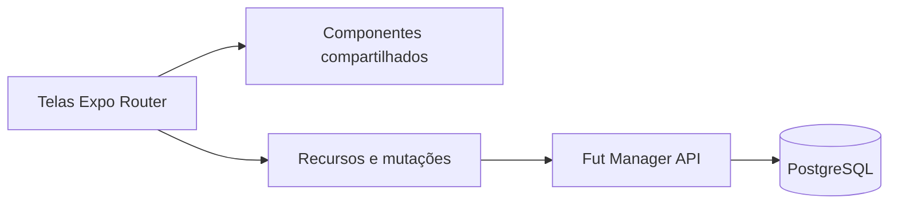

# Fut Manager · Aplicativo

[English](README.md) | **Português (Brasil)**


Fut Manager é um projeto pessoal para levar a organização do futebol amador do grupo de mensagens para um aplicativo: reunir jogadores, montar times, acompanhar partidas e guardar as conquistas de cada campeonato.

A experiência foi construída para uso em campo e já foi testada em um campeonato real. O projeto está em evolução rumo ao MVP, com melhorias baseadas nesse uso.

## Uma jornada completa para jogar e organizar

| Para os jogadores | Para os organizadores |
| --- | --- |
| Entrar em grupos e times por convite | Aprovar pedidos e gerenciar elencos |
| Confirmar presença como jogador ou goleiro | Configurar vagas e listas de espera |
| Acompanhar partidas e estatísticas | Montar e equilibrar times |
| Consultar rankings e troféus | Registrar súmulas, resultados e punições |
| Seguir campeonatos sem participar | Criar competições e sortear grupos |

## Campeonatos e times

O aplicativo oferece **liga, grupos + mata-mata, mata-mata e cascata**. Cada edição tem um menu com inscrições, times, jogos, resultados, classificações, rankings e troféus.

- **Liga livre:** qualquer quantidade de times a partir de dois, com turno único ou ida e volta e folgas para quantidades ímpares.
- **Sorteio de grupos:** distribuição aleatória, além do ajuste manual antes dos registros de jogo.
- **Goleiro titular:** predefinido pelo time e preenchido automaticamente nos jogos. O organizador confirma as substituições durante a partida, com gols sofridos contabilizados para cada goleiro.
- **WO:** vitória de 3 a 0 para o time presente, sem atribuição dos gols a jogadores.
- **Punições:** perda de pontos ou desclassificação da edição, com motivo registrado e revisão antes da confirmação.
- **Súmula resumida:** registros repetidos aparecem juntos, como `2x Gols · Jogador`, mantendo a possibilidade de remover uma ocorrência durante o jogo.
- **Sala de troféus:** os times guardam os títulos conquistados; a edição apresenta os troféus coletivos pelo nome do time.
- **Prêmios individuais:** um único vencedor em artilharia, assistências e melhor goleiro, com a classificação do time como desempate.
- **Feed:** jogos, resultados e estatísticas disponíveis para qualquer usuário autenticado, mesmo sem inscrever um time.

## Peladas e temporadas

Grupos têm membros, convidados, eventos recorrentes, confirmação de presença, filas de espera, montagem de times, cronômetro e registros de gols, assistências e cartões. Rankings e temporadas mantêm o histórico; perfis reúnem posições preferidas e conquistas.

Os administradores podem configurar o sorteio dos times para considerar posições, avaliações e desempenho. Convites ficam privados e podem ser renovados pelo responsável.

## Tecnologia

**Expo SDK 57 · React Native · React 19 · TypeScript · Expo Router**

Uma base de código atende Android, iOS e web. A distribuição atual prioriza **web/PWA**, com configuração para gerar builds nativos. Componentes compartilhados mantêm a mesma experiência de súmula e rankings em peladas e campeonatos.

O aplicativo consome a **Fut Manager API**, projeto complementar em Python/FastAPI e PostgreSQL. A API aplica as permissões e as regras de competição e protege os dados pessoais armazenados.



## Executar localmente

1. Instale Node.js compatível com o SDK 57 e as dependências com `npm ci`.
2. Configure `EXPO_PUBLIC_API_URL` em um `.env.local` privado, conforme `.env.example`.
3. Inicie a API complementar com as migrations atualizadas.
4. Execute:

```powershell
npm start
```

Para a versão web, execute `npm run web`. A geração da PWA usa `npm run build:pwa`. As instruções de build nativo estão em [BUILD_ANDROID.md](BUILD_ANDROID.md).

## Web para desktop, celular e tablet

A mesma URL atende todos os dispositivos. No modo automático, celulares e tablets
usam a interface mobile, incluindo tablets largos e iPads. Computadores usam o
layout desktop: menu lateral, cabeçalho com perfil e listas em duas ou três colunas.
Ao reduzir a janela, o menu vira uma barra compacta ou uma navegação no topo e
o conteúdo se reorganiza para caber na tela. Formulários, jogos e tabelas usam
a mesma API e as mesmas permissões nas duas visualizações.

A escolha na aplicação é sempre automática: não há seletor de visualização nem
preferência de layout salva pelo site. Para solicitar a versão desktop no celular,
use **Versão para computador** nas configurações do próprio navegador. O site
segue a identificação enviada pelo navegador; preferências antigas do site não
interferem mais. A versão nativa mantém o layout mobile.

Para publicar, gere novamente a PWA com `npm run build:pwa` e distribua a pasta
`dist` pelo fluxo de hospedagem existente. Não há outro frontend nem outro
deploy para desktop, e a API não precisa de alteração para esta funcionalidade.

As variáveis `EXPO_PUBLIC_*` são públicas no bundle: use-as apenas para configuração do cliente, nunca para credenciais do banco ou chaves de criptografia.

## Qualidade e estrutura

```powershell
npm run lint -- --no-cache
npx tsc --noEmit
node --test tests/*.test.mjs
```

- `src/app`: telas e navegação.
- `src/components`: componentes de campeonatos, partidas, rankings e formulários.
- `src/hooks`: carregamento de recursos e envio de operações.
- `src/services`: contratos da API e utilitários.
- `src/contexts`: autenticação e sessão.
- `public`: recursos da PWA.

## Mais sobre o projeto

- [Mudanças após os testes do campeonato](Feedback.md)
- [Documentação técnica anterior](docs/DEVELOPMENT.md)
- [Build Android](BUILD_ANDROID.md)

Desenvolvido por **Pedro Vieira**, como projeto pessoal de portfólio.
